  

  
  
  

**Counter-Strike Nexon: Revived** is Counter-Strike Nexon: Zombies played offline, on your own PC, against room bots that play every mode: a local
server (accounts, rooms, shop, inventory, missions, medals), client patches, and `botassist`, which gives the bots
an AI for each mode (Zombie Giant, Zombie Scenario, Human Scenario, Zombie Tag, Soccer, All Star, Item Battle and
more).

**It doesn't include the game:** you need Counter-Strike Nexon: Zombies (free on Steam). If you don't have it, the
launcher gets it for you.

## Installing and playing

### The easy way: the launcher does everything

1. Download **`CSNZ-Revived-Launcher.exe`** from the
   [latest release](https://github.com/ElSerbe/Counter-Strike-Nexon-Revived/releases/latest) and put it in a
   folder of its own (for example `Documents\CSNZ Revived`).
2. Open it. If Windows says *"Windows protected your PC"*, click **More info > Run anyway** (the launcher is new and
   not signed yet; see [Antivirus warnings](#antivirus-warnings)).
3. Click **Install**. The launcher finds your game, or installs it if you don't have it (with Steam, or by
   downloading the same version from the Internet Archive), downloads the mod and patches the game. It keeps a copy of
   every game file it changes, so it can always put the original back.
4. Click **Play**. The first time, Windows asks for administrator rights: say yes (it keeps the game offline, on
   your own PC).

That's it. Updates install by themselves: the launcher checks GitHub when it opens and every hour while it's open,
and updates the mod and itself when a new version is out (after you close the game, if it's running). The **AUTO**
end of the update button turns that on (green, ON) or off (red, OFF); when it's off, the button says **Update**
and one click does it.

Don't have the game, or want it again? **More > Download the game (Steam or archive.org)...** opens the same window
the launcher shows when it can't find the game.

Handy extras in the launcher:

- **More > Create a desktop shortcut that starts the game**: one double click and you're in the game.
- **Store assets**: extracts the item pictures and 3D previews for the in-game shop and pages (it asks once). The
  shop shows a small note when they're missing.
- **Online play**: play with friends through Steam (Steam must be open).
- **Logs > Report a problem on GitHub...**: something went wrong? See [Reporting a problem](#reporting-a-problem).

What the launcher does, in detail

- **The game:** it finds it in Steam's libraries (app 273110). If it isn't installed, a window offers **Install with
  Steam**, or downloads the copy of the same Steam version kept on the Internet Archive
  ([csnz-1362486462562801379](https://archive.org/details/csnz-1362486462562801379)): 12.9 GB, resumable, checked
  against archive.org's MD5, unpacked into the folder you choose (about 27 GB free needed while installing). The
  repository doesn't host the game. A copy that isn't a Steam library install gets the Goldberg Steam Emulator's
  `steam_api.dll` in its `Bin` on Play, so it starts without the game on your Steam account (v0.2.5 from its
  author's GitLab, see `mod\tools\goldberg`, LGPL v3; Valve's is kept for online play).
- **The mod** is installed next to the launcher, in `mod\`. Don't open the launcher from the browser's downloads bar:
  the browser runs a new temporary copy each time (the launcher offers to move itself to `Documents\CSNZ Revived`
  when that happens).
- **Play:** the first time, it adds the hosts block (the game's Nexon addresses go to 127.0.0.1; the only thing that
  needs administrator rights), makes the local server's certificate, patches the game, starts the local server and the
  game (which asks for administrator rights itself), and stops the server when the game closes.
- **Store assets:** runs the mod's Python scripts on your game's files. Without Python, it offers to download the newest
  installer from python.org (checked to be signed by the Python Software Foundation) and installs it for your Windows
  user only, then adds the `pefile` package.
- **Under the game's folder** it shows the game's state (original, patched, or not matching this release) and a
  **Patch the game** / **Unpatch (original game)** button: unpatching puts the original files back and takes the
  mod's files out of `Bin` (keeping your `botassist.ini`). If a backup is missing it offers Steam's *Verify integrity
  of game files*. **More > Remove the hosts block** is the other half of going back online.
- If Steam updates the game, the patches no longer fit: the launcher says so and doesn't touch anything until a
  release for the new version is out.

### The manual way (advanced)

If you'd rather not use the launcher, these are the same steps by hand. You need
[Python 3](https://www.python.org/downloads/) with the `pefile` package (`py -m pip install pefile`).

1. **Install the game** with Steam (or download the
   [Internet Archive copy](https://archive.org/details/csnz-1362486462562801379)).
2. **Download** `CSNZ-Revived-<version>.zip` from the
   [latest release](https://github.com/ElSerbe/Counter-Strike-Nexon-Revived/releases/latest) and unzip it
   into a folder. You get a `mod` folder.
3. **Back up the game** (to be able to undo): copy the game's `Bin` folder to `mod\backup\original\Bin`.
4. **Patch the game** (in a terminal, in the folder that has `mod`):
   `py mod\tools\apply_patches.py "C:\...\Counter-Strike Nexon Zombies\Bin" apply`
5. **Keep it offline:** open Notepad as administrator, open `C:\Windows\System32\drivers\etc\hosts`, paste the
   lines of `mod\tools\hosts_block.txt` at the end and save.
6. **Make the server's certificate** (once):
   `powershell -ExecutionPolicy Bypass -File mod\tools\make_server_cert.ps1`
7. **Play:** double-click `mod\server\run_server.cmd` (the local server; leave it open), then start the game as
   administrator from its `Bin` folder: `cstrike-online.exe --proxy-server=http://127.0.0.1:9` (the address keeps the
   game's built-in browser off the internet).

To undo it: `py mod\tools\apply_patches.py "C:\...\Bin" revert` and take the lines back out of the hosts file.
Updates are the same steps with the new release's zip.

### Online play

Online play goes through the real Steam client, with Spacewar, so Steam has to be open and any Steam account works. The
Steam bridge always uses Valve's own `steam_api.dll`: if the game's `Bin` has another one (a Steam emulator), the bridge
uses a copy kept in `mod\tools\steambridge\out`, or downloads that one file from the archive.org copy of the game.
Leaving a room on another player's server takes you back to your own (as `/home` in the lobby chat does).

### Studio maps

Studio (Create, the editor and its game rooms) works offline. Every map has a **share code** (like `ZQAH-Y6Y9`),
shown at the start of its description in the game and on the **Studio maps** page (Shop > Studio maps). With
**Online play** on, a friend types the code in the game's Studio search and gets the map from your PC over Steam
while you're online. **Publish online** on that page lists the map for every player online: the online maps show up
in the game's Studio browser and in the page's Online maps tab. A map someone downloaded can be passed on by their PC
too, and a Studio room on another player's server downloads its map by itself.

### What each mode gives

Every finished match gives EXP and medals, and advances orders, bingo and Zombie Disaster Zone traits. On top of that
(`mod\server\CSNZ_Server\bin\Data\ModeRewards.json`, from the game's own item texts and the
[CSO wiki](https://cso.fandom.com/wiki/Item)):

- **Zombie Scenario**: a clear gives a Daily Reward Box by difficulty (a harder clear upgrades it while it's unopened;
  once opened, the next comes after midnight), and each season 1 to 4 map gives its clue. Rift Tickets as before.
- **Human Scenario**: Desert Storm, Hellfire and Blaze each give their data item, Sidewinder one of the three, and
  Mosque an EXP Medal to the top 3. Rift Tickets as before.
- **Challenge**: an EXP Medal to the top 3. **Zombie File**: a 1-Day or 2-3 Day Durable. Rift Tickets as before.
- **Dr. A's bags**: holding every clue of a set, the clues become his bag, with one of his items for 30 days.
- **Any mode**: a 15% chance of a Parts Reward Box for a finished match with a kill (the sources don't list this per
  mode; it's the game's "Game Result Reward", and the chance is in that file).

### Gift codes

Each account can use each code once: in the shop page (**Redeem code**, top right) or with `/redeem <code>` in the
lobby chat, in any case and with or without spaces.

- **Stop Killing Games**: 5 of every decoder in the game.
- **Welcome**: 3 Point Coupons (100 points each), M1911 A1 (permanent), MP7A1 Unicorn (90 days), MG42 (permanent),
  15 Bingo Tickets and 5 Advanced Decoders.

The codes are in `mod\server\CSNZ_Server\bin\Data\RedeemCodes.json`. Advanced Decoders aren't sold in the game's
shop; the shop page's Supply Depot sells them for 60 medals each.

### Antivirus warnings

The launcher and the mod's programs are new, unsigned and downloaded by few people, which is what makes antivirus
programs suspicious of them (Microsoft Defender's `Wacatac.B!ml` and Malwarebytes' `MachineLearning/Anomalous` are
machine-learning guesses, not a known threat). Everything is built from the source in this repository:

- **The launcher** downloads the mod from this repository's releases, patches your game (with a backup of every file),
  adds the hosts block (the only thing it asks administrator rights for) and starts the local server and the game.
- **botassist.asi** is loaded by the game (the bots' AI); **CSNZ_Server.exe** is the local server;
  **CSNZ-SteamBridge.exe** carries Online play through Steam; **nartool.exe** reads the pictures out of your game's
  own files with the game's `FileSystem_Nar.dll`, only when you extract the pictures.

There's no need to turn your antivirus off. If it stops one of them:

1. Restore it from the antivirus' quarantine (or, in the launcher, **Download the mod again**: the launcher notices
   when one of the mod's programs is gone and offers it).
2. Add two folders as exceptions: the launcher's folder (with `mod\` inside) and the game's `Bin` folder. In Windows
   Security: *Virus & threat protection > Manage settings > Exclusions > Add or remove exclusions > Add an exclusion >
   Folder*. **More > Antivirus warnings: is this safe?** in the launcher shows both folders with a Copy button, opens
   Windows Security and opens this launcher's VirusTotal page (by its SHA-256, nothing is uploaded).
3. Tell us which antivirus and which file: we report them as false positives to the vendor.

### Reporting a problem

Something doesn't work? In the launcher: **Logs > Report a problem on GitHub...** (also in **More**). It opens the
[problem form](https://github.com/ElSerbe/Counter-Strike-Nexon-Revived/issues/new?template=bug_report.yml)
with your versions filled in and gets your logs ready to paste or drag in (you need a free GitHub account). Prefer to
talk? Ask on [Discord](https://discord.gg/fjxubwyhYv).

The logs help a lot. For a problem that's hard to catch:

1. Turn on **Detailed logs** under the game's folder (the local server and the Steam bridge log every packet; turn it
   off again afterwards, the files get bigger).
2. Play until the problem happens, then close the game.
3. **Logs > Copy the last session's logs** puts everything in the clipboard: the launcher, the Steam bridge, the
   local server and the game (`Bin\Error.log`, `botassist.log`). The same text is in `mod\logs\last-session.txt`.

## The repository

| Path | What |
|---|---|
| `launcher/` | The launcher (C#, .NET Framework 4.8, no install needed on Windows 10/11). |
| `mod/server/` | The local server, based on [JusicP/CSNZ_Server](https://github.com/JusicP/CSNZ_Server) (GPL-3.0); our changes are `mod/server/patches/`. |
| `mod/tools/apply_patches.py` | The client patches (each one checks the original bytes first). |
| `mod/tools/botassist/` | The bots' AI, loaded by the game as `botassist.asi`; one file per mode in `modes/`. Its README has the reverse-engineering notes. |
| `mod/web/` | The in-game web pages (shop, profile, missions, AI player editor). |
| `mod/tools/release/build_release.py` | Builds a release into `dist/`. |

## Authors

- **ItsYuri** ([ItsYuriil](https://github.com/ItsYuriil)): the offline port and rework: bot AI, game modes, items,
  shop, missions, gameplay, new features and quality of life. Discord: https://discord.gg/fjxubwyhYv.
  Enjoying it? Support the development on Patreon: https://patreon.com/ltsYuri
- The local server is based on [JusicP/CSNZ_Server](https://github.com/JusicP/CSNZ_Server) by Jusic, Hardee,
  NekoMeow, Smilex_Gamer and xRiseless.

## Making a release

1. Build what Git doesn't keep: `botassist.asi` (`mod/tools/botassist/README.md`), `CSNZ_Server.exe`
   (`mod/server/README.md`) and `nartool.exe` (`mod/tools/nartool/build.cmd`).
2. Raise `mod/VERSION`, commit, then `python mod/tools/release/build_release.py`. With `CSNZ_SIGN_CERT` set to a code
   signing certificate's thumbprint it signs our programs first (see the script's header).
3. `gh release create v<version> dist/CSNZ-Revived-<version>.zip
   dist/CSNZ-Offline-Revived-<version>-for-old-launchers.zip dist/CSNZ-Revived-Launcher.exe`. The second zip is the
   same one under the project's old name: launchers up to v1.1.30 only look for that name. Players don't need it.

The launcher compares the release's tag with `mod\VERSION` (and with its own version) to offer the update.
